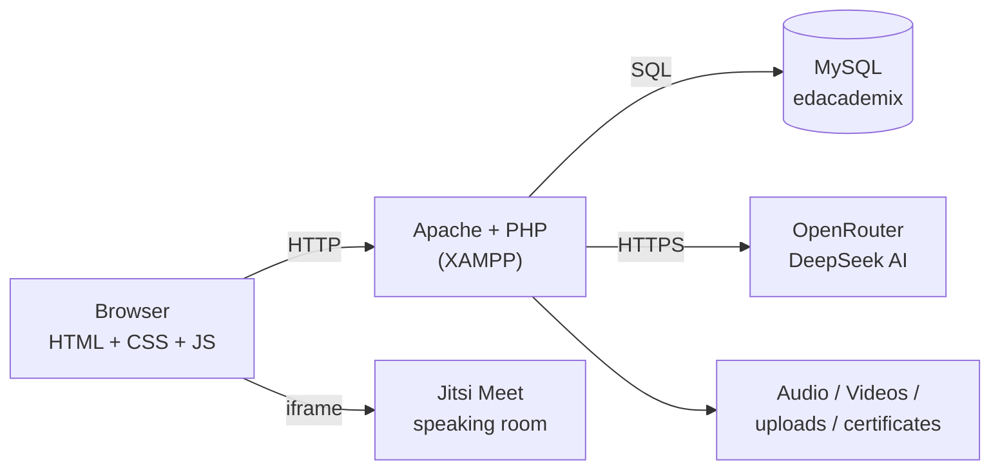

<p align="center">
  
</p>

<h1 align="center">EdAcademix - Study-Abroad Guidance + IELTS Preparation Platform</h1>

<p align="center">
  Choose a country and university, practise all four IELTS skills with AI and examiner feedback,<br>
  earn a certificate and start your application - in one web platform for Bangladeshi students.
</p>

<p align="center">
  
  
  
  
  
  
  
  
</p>

---

## Table of Contents

1. [About the project](#about-the-project)
2. [Features](#features)
3. [Countries and universities](#countries-and-universities)
4. [IELTS Prep hub](#ielts-prep-hub)
5. [Tech stack](#tech-stack)
6. [Architecture](#architecture)
7. [Project structure](#project-structure)
8. [Database](#database)
9. [Getting started](#getting-started)
10. [Known limitations and roadmap](#known-limitations-and-roadmap)
11. [Documentation](#documentation)
12. [Authors](#authors)

---

## About the project

Students who want to study abroad need two things at once: reliable information about **where to apply** and proof of
**English proficiency (IELTS)**. Today they use separate websites for rankings, fees, scholarships and requirements,
pay for coaching without knowing their level, and re-enter the same documents for every application.

**EdAcademix** puts the whole journey in one place:

1. explore **5 countries and 20 universities** - programs, tuition, scholarships and admission requirements,
2. find universities that match your **IELTS score**,
3. **practise IELTS** - Reading and Listening are auto-marked, Writing is evaluated by an AI examiner, Speaking is a live video test with an administrator,
4. track progress on a **dashboard**, and earn a **certificate** at band 6 or above,
5. submit an **Offer Letter Request** with all documents.

It is the extended successor of our earlier **GlobalEdX** project (3 countries, 9 universities) and adds scholarships,
per-level pages, the complete IELTS hub, certificates and an admin panel.

## Features

| Module | What it does |
|---|---|
| **Country explorer** | 5 countries; About page plus Program-wise, Tuition-fee-wise, World-ranking-wise views and name search |
| **University profiles** | 20 universities with fields of study, Undergraduate / Graduate / PhD programs, tuition per level, **scholarship details** and admission requirements |
| **Preferred University finder** | Choose country, program and IELTS score to see universities whose language requirement you meet |
| **IELTS tests** | Listening, Reading, Writing and Speaking, 3 sets each, official-style band conversion |
| **AI writing evaluation** | Essays and letters are scored by a language model (band + written feedback) |
| **Live speaking test** | Student and examiner meet in a Jitsi video room; the examiner records band and feedback |
| **Dashboard** | Average band, section analysis, trend chart (Chart.js), dark mode, IELTS chatbot (rule-based) |
| **Courses and tips** | Tips pages and ordered video lessons for each skill (41 videos) |
| **Certificate** | Students with an overall band of 6 or more apply and receive a generated PDF certificate |
| **Offer Letter Request** | One form collecting personal data and **11 documents** |
| **Admin panel** | Users and results, speaking sessions, offer-letter requests, certificate requests, contact messages, reports |

<!--
### Screenshots
Add your screenshots to docs/screenshots/ and uncomment the lines below.

| Home | Country page |
|---|---|
|  |  |

| IELTS dashboard | Admin panel |
|---|---|
|  |  |
-->

## Countries and universities

| Country | Universities |
|---|---|
| Australia | Australian National University, University of Melbourne, University of Sydney, University of Queensland |
| England | University of Cambridge, University of Oxford, Imperial College London, University College London |
| Germany | Heidelberg University, Ludwig Maximilian University of Munich, Technical University of Munich, Charit&eacute; Berlin |
| Italy | University of Bologna, University of Padua, Politecnico di Milano, Sapienza University of Rome |
| USA | Harvard University, Massachusetts Institute of Technology, Stanford University, California Institute of Technology |

## IELTS Prep hub

| Module | How it works | Marking |
|---|---|---|
| **Reading** | 3 sets, passages + 40 questions each | Automatic; raw score out of 40 converted to a band |
| **Listening** | 3 sets, one audio recording per set (`Audio/`) | Automatic; own raw-score-to-band table |
| **Writing** | Letter + essay per set | AI examiner (Task Response, Coherence, Lexical Resource, Grammar) returns `{score, feedback}`; band = average |
| **Speaking** | Live Jitsi room with an administrator | Examiner enters band and feedback |

Each set can be taken once, so a student has **three attempts per module**. The AI score is a **practice estimate, not an
official IELTS result**. *IELTS is a trademark of its owners; this project is not affiliated with them.*

## Tech stack

| Layer | Technology |
|---|---|
| Front end | HTML5, CSS3, JavaScript, Bootstrap 5.3.3, Font Awesome, Chart.js |
| Back end | PHP 8 (MySQLi, sessions, cURL) |
| Database | MariaDB 10.4 / MySQL (`edacademix`, 29 tables) |
| AI | OpenRouter chat-completions API (DeepSeek model) |
| Video | Jitsi Meet external API |
| PDF | FPDF (certificates), TCPDF bundled |
| Server | Apache via XAMPP |

## Architecture



## Project structure

```text
EdAcademix-Study-Abroad-IELTS-Platform/
├── index.php, login.php, signup.php, about.php, contact.php, profile.php   # core pages
├── desh.html ... desh5.html                    # country landing pages (AUS, ENG, GER, ITALY, USA)
├── about_*, uni_*, program_*, tuitionfee_*, rank_*, search_*.php   # country pages (6 x 5)
├── fields_*, pro_academic_*, pro_offer_*, tuition_*, fee_academic_*,
│   scholar_academic_*, req_*.php                # university pages (20 universities)
├── Preferred_university.php                    # IELTS-score based university finder
├── offerletter.php, submit_offer.php           # offer letter request
├── dashboard.php, tests.php, videos.php, bot.php, cert.php, submit_cert.php   # IELTS hub
├── Tests/        # reading, listening, writing (AI), speaking tests + config.example.php
├── Courses/      # tips and course playlists per skill
├── Admin/        # administrator panel
├── Audio/        # 3 listening recordings
├── Videos/       # 41 lesson videos (NOT in Git - see Videos/README.md)
├── universities/ # 20 university pages + 20 contact pages
├── database/     # edacademix.sql (sanitized) + import guide
├── docs/         # logo and full project documentation (PDF)
├── css/, js/, img/, images/, webfonts/, bootstrap-5.3.3-dist/, fpdf/, tcpdf/
├── Offer Letter/, certificate/                 # runtime folders (contents git-ignored)
└── README.md
```

## Database

Database **`edacademix`**, **29 tables**. `database/edacademix.sql` contains the full structure plus all catalogue and
IELTS test content (5 countries, 20 universities, 156 fee and 156 requirement rows, 184 subjects, 240 questions,
9 reading passages, 6 writing tasks, 41 video entries). Rows of user, admin, certificate, offer-letter and test-result
data were **removed**, so no personal data is published. See [`database/README.md`](database/README.md).

## Getting started

### Prerequisites

- [XAMPP](https://www.apachefriends.org/) (Apache, MySQL/MariaDB, PHP 8 with `curl` enabled)
- [Git](https://git-scm.com/)
- Internet access (AI writing evaluation and the Jitsi speaking room)

### 1. Clone into XAMPP's `htdocs`

```bash
git clone https://github.com/Rahil03-git/EdAcademix-Study-Abroad-IELTS-Platform.git C:\xampp\htdocs\EdAcademix
```

### 2. Start Apache and MySQL, then import the database

1. Open <http://localhost/phpmyadmin> and click **New**.
2. Create a database named **`edacademix`** (collation `utf8mb4_general_ci`).
3. Select it, open **Import**, choose `database/edacademix.sql` and click **Import**.

### 3. Add the lesson videos (optional)

Copy the 41 MP4 files into the `Videos/` folder using the names listed in [`Videos/README.md`](Videos/README.md).
Without them the site works; only the lesson player stays empty.

### 4. Configure the AI key (needed for the Writing test)

1. Create a free account at <https://openrouter.ai> and generate an API key.
2. Copy `Tests/config.example.php` to **`Tests/config.local.php`** and paste your key inside.

`config.local.php` is git-ignored - **never commit your key**. (You can also set the environment variable `DEEPSEEK_API_KEY`.)

### 5. Check the connection settings

`connect.php` uses the XAMPP defaults: host `localhost`, user `root`, empty password, database `edacademix`.

### 6. Create the first administrator and open the site

1. Open <http://localhost/EdAcademix/admin_signup.php> and create an admin account, then **delete or protect that page**.
2. Admin login: <http://localhost/EdAcademix/Admin/admin_login.php>
3. Student site: <http://localhost/EdAcademix/index.php> - sign up, log in and try the IELTS tests.

> `Offer Letter/` and `certificate/` must be writable by Apache. Their contents are never committed to Git.

## Known limitations and roadmap

This is an academic prototype. Planned improvements:

- [ ] Compute the certificate eligibility on the server (currently read from the URL) and fix its redirect page.
- [ ] Protect `admin_signup.php` and the speaking-admin pages with an admin-session check.
- [ ] Require login on every test page.
- [ ] Safer uploads: files outside the web root, random names, MIME and size checks.
- [ ] Save half-band scores correctly in `testresults` (bind as decimal) and add `UNIQUE(user_id)` to `speaking_sessions`.
- [ ] Random / authenticated Jitsi room names.
- [ ] Stronger password policy (8+ characters), CSRF protection and central configuration.
- [ ] One parameterised template instead of 250+ near-identical university pages.
- [ ] E-mail delivery of certificates, study-abroad AI advisor chatbot, more IELTS sets and question types.

## Documentation

A complete project report - architecture, real database design, algorithms, security review, test cases and a viva
guide - is in [`docs/EdAcademix_Complete_Project_Documentation.pdf`](docs/EdAcademix_Complete_Project_Documentation.pdf).

## Authors

Developed at **United International University (UIU), Dhaka**.

- **Kazi Shibli Zaman Rahil** - [@Rahil03-git](https://github.com/Rahil03-git)
- **Nazifa Tabassum**
- **Hasan Al Banna**
- **Jannatul Ferdus Setu**
- **Tahmid Ahmed Talukdar**

<!-- Add GitHub links or roles, for example:
- **Name** - role - [@github-username](https://github.com/github-username)
-->

---

<p align="center">Built with PHP, MySQL, Bootstrap and AI.</p>
